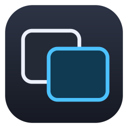

# Win-Mirro-Overlay

[](https://github.com/BearingSteel/Win-Mirro-Overlay/actions/workflows/build.yml)

Mirror any running Windows window into a floating overlay that can stay on top, become
click-through, follow you across virtual desktops, and zoom from 10% to 1000%.



**中文文档：[README.zh-CN.md](README.zh-CN.md)**

> ## ⚠️ 100% AI-generated
>
> This repository — application code, XAML, build scripts, CI workflow and documentation —
> is **entirely generated by AI** (DeepSeek Harness agent), with a human only driving
> requirements and testing on real hardware. Treat it as an AI-produced project: review
> before trusting it in production.

---

## Features

| Feature | Behaviour |
| --- | --- |
| Pick a window | Lists visible top-level windows from **all virtual desktops** with icon, title and process |
| Mirror window | Real-time mirror in a borderless floating window |
| Move / resize | Drag the title bar to move (with Aero snap); drag the edges to resize |
| Pan the picture | Drag inside the picture to pan when zoomed in, clamped to the image bounds |
| Zoom | Continuous **10% – 1000%**: mouse wheel over the window, or the slider in the tray menu |
| Opacity | Continuous **10% – 100%** slider in the tray menu |
| Always on top | Three-state, single choice: on / on + click-through / off |
| Pin button | One click switches to *on + click-through*, then a hint tells you how to get back |
| Click-through | `WS_EX_TRANSPARENT` — mouse events pass straight through the overlay |
| All desktops | Toggle (default on, persisted): the overlay follows you when you switch desktops |
| Remember geometry | Window position/size is restored on the next launch |
| Tray menu | Left or right click the tray icon to open the menu |
| Multiple instances | No single-instance lock; every instance has its own tray icon |
| Languages | English / 简体中文 / 繁體中文, auto-detected, switchable in the tray menu |

## Requirements

**Run:** Windows 10 1809 (build 17763) or later, .NET 8 Desktop Runtime.

**Build:** Visual Studio 2022 (.NET desktop workload) or the .NET 8 SDK.

## Build & run

```powershell
git clone https://github.com/BearingSteel/Win-Mirro-Overlay.git
cd Win-Mirro-Overlay
dotnet run --project src/WinMirroOverlay/WinMirroOverlay.csproj
```

Or open `Win-Mirro-Overlay.sln` in Visual Studio 2022 and press `F5`.

Publish (framework-dependent, `win-x64`):

```powershell
dotnet publish src/WinMirroOverlay/WinMirroOverlay.csproj -c Release -r win-x64 --self-contained false -o publish
```

Self-contained single file (what the release `.exe` is built from):

```powershell
dotnet publish src/WinMirroOverlay/WinMirroOverlay.csproj -c Release -r win-x64 `
  --self-contained true -p:PublishSingleFile=true `
  -p:IncludeNativeLibrariesForSelfExtract=true -p:EnableCompressionInSingleFile=true `
  -o publish-standalone
```

### Downloads

Each [release](https://github.com/BearingSteel/Win-Mirro-Overlay/releases) ships two files:

| File | Needs .NET 8? | Notes |
| --- | --- | --- |
| `WinMirroOverlay-vX.Y.Z-win-x64.exe` | No | Self-contained single file (~70 MB), just double-click |
| `WinMirroOverlay-vX.Y.Z-win-x64.zip` | Yes | Framework-dependent build (exe + DLLs, ~7 MB) |

Every push also produces an Actions artifact.

## Usage

1. Run `WinMirroOverlay.exe` — the picker window appears.
2. Click a window in the list (or select it and press Enter) to start mirroring.
3. Control the overlay with the window buttons or the tray menu:
   - drag title bar = move window, drag picture = pan
   - mouse wheel = zoom at the cursor
   - pin button = always on top + click-through
4. Close the overlay to go back to the picker; exit from the tray menu or by closing the picker.

## Implementation notes

- **Capture**: `Windows.Graphics.Capture` + Direct3D11; frames are copied to the CPU through a
  staging texture and drawn with `WriteableBitmap` at ~30 fps.
- **Fallbacks**: if `FrameArrived` never fires, the frame pool is polled; if the pool stays empty,
  the app switches to `PrintWindow(PW_RENDERFULLCONTENT)` (compatibility mode).
- **Overlay**: WPF layered window (`AllowsTransparency`), `WS_EX_TRANSPARENT` for click-through,
  custom `WM_NCHITTEST` for resizing, layout-based positioning for pan/zoom.
- **Virtual desktops**: the public `IVirtualDesktopManager.MoveWindowToDesktop` is used to follow
  desktop switches (~0.4 s). No undocumented APIs.

## Known limitations

- DRM-protected video and some exclusive-fullscreen games cannot be captured.
- Minimized source windows pause the picture.
- Capturing a window on **another virtual desktop** is usually blocked by Windows; select it after
  switching to that desktop.
- A truly empty target desktop cannot be detected through the public API, so the overlay may not
  follow onto it.
- Click-through makes the overlay ignore all mouse input; use the tray menu to undo.

## Logs and settings

- `%LOCALAPPDATA%\Win-Mirro-Overlay\app.log` — diagnostics
- `%LOCALAPPDATA%\Win-Mirro-Overlay\settings.json` — language, "show on all desktops", window bounds

## License

[MIT](LICENSE)
