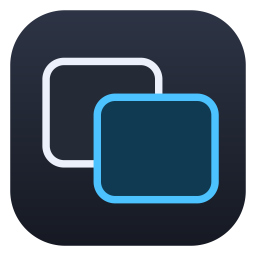

# Win-Mirro-Overlay

[](https://github.com/BearingSteel/Win-Mirro-Overlay/actions/workflows/build.yml)

把任意一个正在运行的 Windows 窗口，**实时镜像**成一个独立的悬浮窗：可置顶、可穿透、可跟随虚拟桌面、分辨率 10%–1000% 连续缩放。



**English: [README.md](README.md)**

> ## ⚠️ 本项目 100% 由 AI 生成
>
> 本仓库的应用程序代码、XAML、构建脚本、CI 流程和文档，**全部由 AI（DeepSeek Harness 智能体）生成**，人类只负责提需求和在真机上验证。请把它当作 AI 产物使用：上生产前请自行审查。

---

## 功能

| 功能 | 说明 |
| --- | --- |
| 选择窗口 | 列出**所有虚拟桌面**上的可见顶层窗口（图标、标题、进程名） |
| 镜像窗口 | 无边框悬浮窗实时显示源窗口内容 |
| 移动 / 缩放窗口 | 拖标题栏移动（支持贴边吸附），拖边框缩放 |
| 平移画面 | 放大后拖画面内部平移，边界自动钳制 |
| 缩放 | 连续 **10%–1000%**：窗口内滚轮，或托盘菜单滑块 |
| 透明度 | 托盘菜单连续滑块 **10%–100%** |
| 置顶 | 三选一：置顶 / 置顶（点击穿透）/ 取消置顶 |
| 钉子按钮 | 点一下进入「置顶 + 点击穿透」，并提示如何恢复 |
| 点击穿透 | `WS_EX_TRANSPARENT`，鼠标事件完全穿过悬浮窗 |
| 所有桌面显示 | 托盘开关，默认开启并持久化；切换虚拟桌面后悬浮窗跟随 |
| 记住位置尺寸 | 关闭后重开，恢复上次的窗口位置和大小 |
| 托盘菜单 | 左键或右键托盘图标都能打开 |
| 多实例 | 不做单实例限制，每个进程各自一个托盘图标 |
| 多语言 | 简体中文 / 繁體中文 / English，自动识别，可在托盘菜单切换 |

## 环境要求

**运行**：Windows 10 1809（build 17763）及以上 + .NET 8 Desktop Runtime。

**编译**：Visual Studio 2022（勾选「.NET 桌面开发」）或 .NET 8 SDK。

## 编译与运行

```powershell
git clone https://github.com/BearingSteel/Win-Mirro-Overlay.git
cd Win-Mirro-Overlay
dotnet run --project src/WinMirroOverlay/WinMirroOverlay.csproj
```

也可以双击 `Win-Mirro-Overlay.sln`，用 VS 2022 打开后按 `F5`。

发布（依赖已安装的 .NET 8 Desktop Runtime）：

```powershell
dotnet publish src/WinMirroOverlay/WinMirroOverlay.csproj -c Release -r win-x64 --self-contained false -o publish
```

单文件、免运行时（Release 里的 exe 就是这么打出来的）：

```powershell
dotnet publish src/WinMirroOverlay/WinMirroOverlay.csproj -c Release -r win-x64 `
  --self-contained true -p:PublishSingleFile=true `
  -p:IncludeNativeLibrariesForSelfExtract=true -p:EnableCompressionInSingleFile=true `
  -o publish-standalone
```

### 下载

每个 [Release](https://github.com/BearingSteel/Win-Mirro-Overlay/releases) 提供两个文件：

| 文件 | 是否需要 .NET 8 | 说明 |
| --- | --- | --- |
| `WinMirroOverlay-vX.Y.Z-win-x64.exe` | 不需要 | 自包含单文件（约 70 MB），双击即用 |
| `WinMirroOverlay-vX.Y.Z-win-x64.zip` | 需要 | 依赖框架的版本（exe + 若干 DLL，约 7 MB） |

每次推送也会生成 Actions artifact。

## 使用流程

1. 运行 `WinMirroOverlay.exe`，出现选择窗口。
2. 单击列表里的窗口（或选中后回车）开始镜像。
3. 用悬浮窗按钮或托盘菜单控制：
   - 拖标题栏 = 移动窗口，拖画面 = 平移
   - 滚轮 = 以光标为中心缩放
   - 钉子 = 置顶 + 点击穿透
4. 关闭悬浮窗会回到选择窗口；托盘「退出」或关闭选择窗口才真正结束程序。

## 实现说明

- **采集**：`Windows.Graphics.Capture` + Direct3D11，帧经 staging 纹理拷到 CPU，用 `WriteableBitmap` 以约 30fps 绘制。
- **兜底**：`FrameArrived` 不触发时改为轮询帧池；帧池仍为空则切换到 `PrintWindow(PW_RENDERFULLCONTENT)`（兼容模式）。
- **悬浮窗**：WPF 分层窗口（`AllowsTransparency`），穿透用 `WS_EX_TRANSPARENT`，自绘 `WM_NCHITTEST` 处理缩放，平移/缩放用布局定位。
- **虚拟桌面**：用公开的 `IVirtualDesktopManager.MoveWindowToDesktop` 跟随桌面切换（约 0.4 秒），不调用未公开接口。

## 已知限制

- 受 DRM 保护的视频、部分独占全屏游戏无法捕获。
- 源窗口最小化时画面暂停。
- 抓取**其它虚拟桌面**上的窗口通常会被 Windows 拒绝，请先切到该桌面再选。
- 目标桌面一个窗口都没有时，公开接口无法判断当前桌面，悬浮窗可能不会跟随过去。
- 开启点击穿透后悬浮窗不再接收鼠标事件，只能用托盘菜单恢复。

## 日志与设置

- `%LOCALAPPDATA%\Win-Mirro-Overlay\app.log` — 诊断日志
- `%LOCALAPPDATA%\Win-Mirro-Overlay\settings.json` — 语言、「所有桌面显示」、窗口位置尺寸

## License

[MIT](LICENSE)
